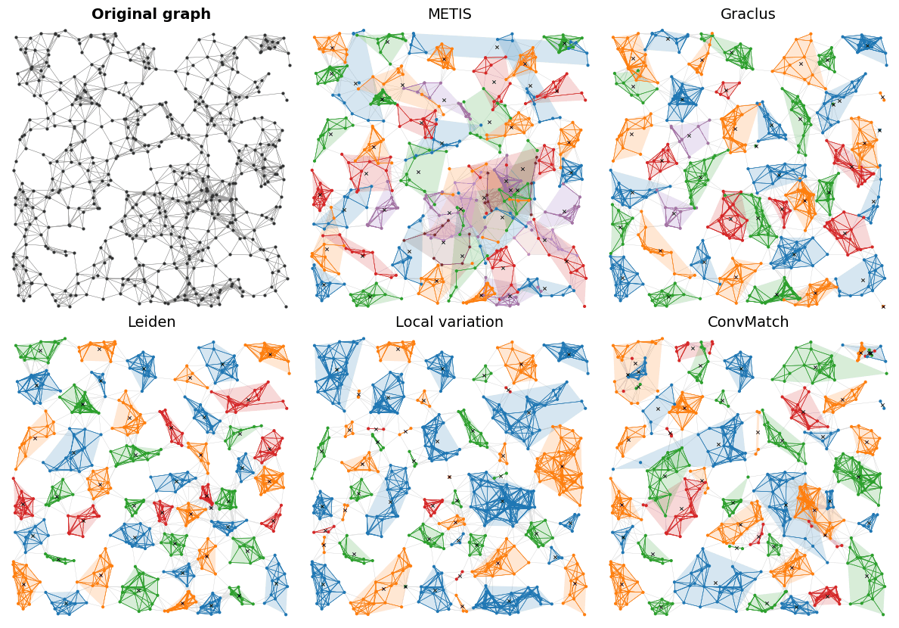

<p align="center">
  <picture>
    <source media="(prefers-color-scheme: dark)" srcset="assets/logo_dark.svg">
    
  </picture>
</p>

# GraCo

GraCo is a toolkit of graph coarsening methods. It gathers 17 methods from the
literature and a random baseline behind one interface. It also implements the metrics their
papers use, so that any coarsening can be scored under the metric of any paper.

Every method takes a graph and a reduction ratio `r`. It asks for a partition
of the nodes into `n = (1 - r) N` supernodes; a few methods return another
count, which their `info` reports. GraCo builds the coarsening from that
partition: the lifting matrix Q, the reduction matrix P and the coarsened
graph. Each method runs at the defaults of its paper or of its released code;
the module docstring of each method lists where we depart from both.

<p align="center">
  
</p>
<p align="center"><em>A random geometric graph of 500 nodes coarsened to 50 supernodes.</em></p>

GraCo comes with a paper, *GraCo: A Unified Toolkit of Graph Coarsening
Algorithms and Metrics* (link to come). It describes every method and
metric, the choices of our implementations, and the runtimes below.

## Install

GraCo needs Python 3.11 or later, PyTorch 2.7 or later and PyTorch Geometric
2.7 or later.
Install PyTorch first, built for your CUDA version (see pytorch.org).

```bash
git clone https://github.com/Antonin-J/graco.git graco
cd graco
pip install -e .
```

`pip install .` is enough to use the library. The editable install (`-e`)
keeps the package in the clone, which the scripts of `reproduce/` need: they
write their results next to themselves.

Optional extras, e.g. `pip install -e ".[ogb,viz]"`:

| Extra | Installs | Needed for |
|---|---|---|
| `ogb` | ogb | ogbn-arxiv and ogbn-products |
| `graclus` | torch-cluster | Graclus |
| `leiden` | igraph, leidenalg | Leiden. Both are GPL, so GraCo does not depend on them |
| `viz` | matplotlib | the three figure scripts of `reproduce/` |

## Quick start

```python
from graco import get_dataset, coarsen_local_variation, build_coarsening
from graco.metrics import rsa, convolution_matching_error, max_acc

data = get_dataset("Cora")
partition, info = coarsen_local_variation(data, r=0.5)        # Loukas, JMLR 2019
coarsening = build_coarsening(data, partition)

print(rsa(coarsening, data))                                  # Loukas, JMLR 2019
print(convolution_matching_error(coarsening, data)["total"])  # Dickens et al., 2024
print(max_acc(coarsening, data)["all"])
```

The same example runs with `python -m graco.quickstart`. Datasets download on
first use into `~/.cache/graco/datasets`, or into `GRACO_DATASETS_DIR` when set.

## Methods

Every method is a function `coarsen_*(data, r, **kwargs)` returning
`(partition, info)`, also reachable by the names below through
`get_coarsening_algo(name)`.

| Family | Methods |
|---|---|
| Global clustering | `random`, `metis`, `graclus`, `leiden`, `ugc`, `gw_kgpc` |
| Representative selection | `kcenter`, `herding`, `otcoarsening` |
| Greedy contraction | `local_variation`, `convmatch`, `nope`, `gw_gpc`, `stpgc` |
| Recursive splitting | `sgwl`, `gbgc` |
| Dense optimization | `fgc`, `ipe` |

## Metrics and refinement

`graco.metrics` holds the metrics, most taking the coarsening first and the
original graph second; `check_coarsening` and `cluster_size_distribution`
take the coarsening only, and `dirichlet_energy` takes one graph:

- spectral: `rsa`, `rsa_features`, `mean_REE`, `spectral_distance`;
- energy: `dirichlet_energy`, `dirichlet_energy_error`, `hyperbolic_error`,
  `reconstruction_error`, `fgc_loss`, `convolution_matching_error`,
  `inner_product_error`, `ipe_grassmann_loss`,
  `neighborhood_interference_index`;
- transport: `wasserstein_feature_distance`, `gromov_wasserstein_distortion`,
  and through the solver of SGWL `d_gw_paper`, `d_gw_op`, `d_gw_struct`;
- structural: `max_acc`, `modularity`, `partition_density_quality`,
  `cluster_size_distribution`, `check_coarsening`.

`graco.refinement` keeps the partition and the lifting Q fixed and optimizes
the reduction matrix P, following Joly, Keriven and Roumy, *Taxonomy of
reduction matrices for Graph Coarsening* (NeurIPS 2025).

## Runtime

Time in seconds to coarsen each graph, on an AMD EPYC 7413 CPU, and an NVIDIA
A40 GPU for the methods that run on GPU, at r = 0.9 on Cora and PubMed, 0.99 on ogbn-arxiv and 0.999 on ogbn-products. The budget is
one hour per method on Cora and PubMed, three hours on ogbn-arxiv and twelve
on ogbn-products. OOT: over budget. OOM: out of memory. FAIL: the solver did
not converge. Memory and the details are in Table 2 of the
paper.

| Method | Cora | PubMed | ogbn-arxiv | ogbn-products |
|---|---|---|---|---|
| Random | <0.01 | <0.01 | 0.01 | 0.12 |
| METIS | 0.07 | 0.83 | 4.5 | 84.6 |
| Graclus | 0.04 | 0.21 | 1.5 | 49.7 |
| Leiden | 2.9 | 34.7 | 2718 | 33523 |
| UGC | 0.25 | 0.54 | 3.4 | 35.1 |
| Kcenter | 0.55 | 1.8 | 3.0 | 44.9 |
| Herding | 0.51 | 1.7 | 2.6 | 40.6 |
| Local variation | 0.98 | 3.3 | 100.0 | 3164 |
| Local variation, neighborhood | 10.8 | 10.4 | 288 | 13772 |
| ConvMatch, exact | 4.1 | 2.9 | 19.7 | 2402 |
| ConvMatch (A-ConvMatch) | 5.2 | 2.4 | 18.7 | 2368 |
| NOPE | 0.80 | 9.8 | 1587 | OOT |
| NOPE* | 0.21 | 3.1 | 183 | 55936 |
| FGC | 6.3 | 94.6 | 454 | OOM |
| IPE | 9.9 | FAIL | OOT | OOM |
| GW-GPC | 6.4 | OOT | OOM | OOM |
| GW-KGPC | 0.63 | 51.2 | OOM | OOM |
| SGWL | 6.3 | 61.5 | 1124 | OOT |
| OTCoarsening | 11.6 | OOM | OOM | OOM |
| GBGC | <0.01 | 0.07 | 2.3 | 142 |
| GBGC, METIS init | 0.07 | 0.59 | 7.3 | 362 |
| STPGC | 0.14 | 1.9 | 106 | 16666 |

The default of ConvMatch is its approximate cost (A-ConvMatch). NOPE* overran the twelve-hour budget of
`run_scaling` on ogbn-products; its cell comes from the one-cell command,
which has no budget:

```bash
python -m graco.reproduce.scaling --dataset ogbn-products --r 0.999 --algo nope_star
```

On ogbn-products, the resolution search of Leiden stops before a third run
would overrun the budget, at 599 supernodes for the 2386 asked. At these
ratios, GBGC stops on its own quality criterion and returns more supernodes
than asked.

## Reproducing the paper

[`reproduce/README.md`](reproduce/README.md) maps every table and figure of the GraCo paper to one
command.

## License

MIT ([`LICENSE`](LICENSE)), except `algorithms/convmatch.py`, `algorithms/fgc.py` and
the passages of `algorithms/local_variation/` that come from Apache-2.0
sources, kept under that license ([`licenses/Apache-2.0.txt`](licenses/Apache-2.0.txt)).
[`THIRD_PARTY_NOTICES.md`](THIRD_PARTY_NOTICES.md) gives their notices.

## Citation

If you use GraCo, please cite the paper above. Its arXiv link and BibTeX entry
will be added here once it is online.

Questions and bug reports go to the
[GitHub issues](https://github.com/Antonin-J/graco/issues).
